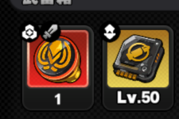

# 贝果物品角标素材

本目录统一保存物品角标的来源图、局内参考帧和模板重建参数。画面规则见[贝果格子说明](../../贝果计划.md#格子)，分类与优先级见[自动化说明](../../../../develop/zzz/application/bagel.md#物品识别与优先级)。

整屏归档图均为 1920×1080，不缩放；右下 `[1780,1050,1920,1080)` 涂黑遮挡账号标识（UID），物品格保持原样。局部图在对应章节注明裁剪矩形。来源和裁剪参数统一记录在本文，不另建清单。

## 仓库源图

仓库图的来源为上传 PNG，归档格式为无损 WebP。遮挡区域以外的像素与源文件一致。上传前的采集与压缩历史未知，不能仅凭 PNG 扩展名认定为原始采集像素。

| 文件 | 画面 | 用途 |
| --- | --- | --- |
| [warehouse_blueprint.webp](warehouse_blueprint.webp) | 详情显示「[蓝图]骸影·太初梦魔」；选中格左上是白色卷页 | 核对蓝图类型与真实格子角标 |
| [warehouse_anticorrosion.webp](warehouse_anticorrosion.webp) | 详情显示「高阶抗蚀器」；蓝图所在行没有选中边框 | 蓝图模板裁剪源、非蓝图对照 |
| [warehouse_backpack.webp](warehouse_backpack.webp) | 详情显示「邦邦大背包」 | 背包模板裁剪源、非蓝图对照 |
| [warehouse_blade.webp](warehouse_blade.webp) | 详情显示「高阶异体刃·强斩」 | 非蓝图对照 |

仓库非蓝图详情图的右侧仍显示蓝图。`warehouse_blueprint.webp` 中蓝图位于第三可见行，其余图中位于第二可见行。顶部一行角标被标题遮挡，不作为完整角标样本。

## 局内录像帧

录像标识为 `2026-10-20 10-13-33.flv`，视频流为 1920×1080、60 FPS。通过 OpenCV `VideoCapture` 按毫秒定位后读取，将 BGR 转为 RGB、遮挡 UID，再无损保存。原录像不在仓内；归档帧可独立用于识别复核，不依赖外部录像路径。

无损编码保留视频解码像素，不恢复录像压缩前的采集精度。单帧只支持角标和品质的核对，不能证明连续拖拽、对换或结算成功。

| 文件 | 相对录像时间 | 可核对范围 |
| --- | --- | --- |
| [search_result_valuable_reward.webp](search_result_valuable_reward.webp) | 00:38:00 | 电子保险箱搜索结果第 5 格为 Z 品质，使用第二种钻石角标；安全箱第 3 格使用原有钻石角标 |
| [search_safe_valuable_reward.webp](search_safe_valuable_reward.webp) | 00:38:02 | 同一物品在安全箱第 5 格，角标完整；第 3 格仍有原有钻石角标 |
| [search_safe_blueprint.webp](search_safe_blueprint.webp) | 01:06:30 | 电子保险箱搜查中；安全箱第 3 格显示 Z 蓝图，格心 `(461,899)`；相邻格为非蓝图 |
| [search_result_blueprint.webp](search_result_blueprint.webp) | 01:42:30 | 武备箱搜查中；搜索结果第 2 格显示 S 蓝图，格心 `(1443,330)`；第 1 格为 Z 非蓝图，第 3 格正在揭示 |
| [search_result_backpack.webp](search_result_backpack.webp) | 03:05:25 | 武备箱搜索结果第 4 格为 A 品质背包，左上为背包角标 |
| [search_safe_backpack.webp](search_safe_backpack.webp) | 03:05:29 | A 品质背包位于安全箱第 4 格；相邻第 2 格为蓝图，第 3 格为普通战术道具 |

第二种钻石角标对应菲林／零号业绩，类型含义来自维护者说明。局内帧包含菲林外观，但未打开详情；零号业绩的独立物品格样本尚未归档。

普通骸影的同名对照另见测试仓 `zzz-od-test/screens/贝果-备战/clear_loadout_dense_detail.webp`，来源索引见[启动清空相关画面](../../贝果计划.md#启动清空相关画面)。该图详情显示「骸影·太初梦魔」，左侧物品格为战术道具角标，不是卷页角标。不能按名称将普通骸影视为蓝图。

## 角标顶部覆盖

`search_result_badge_top.png` 来自运行自动保存的 1920×1080 原生 PNG，源图标识为 `BagelStoreSafe_1792771368620.png`。归档仅裁出 `[1280,160,1505,310)`，以 PNG 无损保存，不缩放、不增强，不包含账号标识。局部图已保留核对所需像素，不依赖临时源图路径。

左格为红底战术道具，右格为金底战术棱镜。两个类型角标模板的完整匹配矩形分别为 `[1305,188,1329,212)` 和 `[1406,188,1430,212)`。这些是模板覆盖范围，不是格心或游戏卡片边界。该图第一排实际格心 y≈245；若误用 y=256，搜索框会从 y=191 开始，遗漏角标顶部 3 像素，底部取样也会偏下。自动化须先确认整排位置，具体范围见[品质与角标识别](../../../../develop/zzz/application/bagel.md#品质与角标识别)。

本图只证明这两格的外观和角标位置，不能证明游戏接受拖拽，也不能推定所有容器的角标高度一致。

## 新赛季格子定位

古怪试炼结果区存在两组已量测的纵向排布，列位置和两排行距基本一致。素材按赛季区分：`2026-10-21 tmp.flv` 与近期实机运行录像属于新赛季；`2026-10-20 10-13-33.flv` 属于第一赛季，只作历史外观参考，不能用于校准新赛季结果格。

| 源图 | 内容与处理 | 结果区定位 |
| --- | --- | --- |
| [result_panel_high.png](result_panel_high.png) | 原生 1080p 停止截图 `BagelStoreSafe_1792771368620.png`，裁出 `[1240,100,1860,590)`，PNG 无损保存 | 两排格心 y≈245/366；上边缘约 191/312 |
| [result_panel_low.png](result_panel_low.png) | 运行录像 `20261023-164658-368419-verify/record.mp4` 的 160 秒帧，3840×2160 通过 INTER_AREA 缩为 1080p 后裁同一区域；PNG 无损保存 | 两排格心 y≈256/377；上边缘约 202/323 |

外框约宽 92、高 109 像素，列中心约 `1353、1453、1554、1655、1756`，行距 121。两组整体高度相差 11 像素；造成排布差异的游戏条件尚未确认，不能仅按分辨率或容器名称选择坐标。局内安全箱在这些素材中位于约 `X=259、360、461、562、663，Y=898`，不随右侧面板一起上移。

表中外框是边缘检测的包围范围，存在约一像素的抗锯齿与录像压缩误差；模板、品质和底部文字各有独立取样区域，不应将取样框当成游戏卡片边框。局部归档图不能作为整屏输入。对应自动化位置约束与未知范围见[搜查面板可操作性](../../../../develop/zzz/application/bagel.md#搜查面板可操作性)。

## 品质取样对照

[quality_samples.png](quality_samples.png) 保存 69 个古怪试炼物品格的原尺寸裁图。每格 130×130，局部格心为 `(65,70)`；图册间距与标签不属于源图。对应[样本清单](quality_samples.json)记录来源标识、录像时间或帧名、原图格心、图册裁剪矩形、人工底色标签及各方法输出。标签按可见底色核对，不以识别算法输出作为真值。

素材包含停止截图的 2 格、两次近期运行截图的 53 格，以及 `2026-10-21 tmp.flv` 的 14 格。近期运行截图已标准化为 1920×1080；FLV 解码帧为原生 1080p。裁图无缩放、无增强，PNG 无损保存解码像素。69 格是观测数，包含同一物品在不同时刻、不同位置的重复，不是 69 种独立物品。两组结果区高度和局内安全箱均有覆盖；品质包含 Z/S/A/B，没有 C 品质样本。

所有方法使用同一已校准格心、相同 HSV 色带和 40 的饱和度／亮度阈值。左上包含、右下不包含：

| 方法 | 相对格心取样区域 | 识别正确 | 格心 ±2 像素偏移检查中的错误 |
| --- | --- | --- | --- |
| 整块最高饱和度 25% | `[-44,-54,44,54)` | 62/69 | 175/1725 |
| 去掉文字后取最高饱和度 25% | `[-38,-46,38,26)` | 50/69 | 475/1725 |
| 基线双长条、重新定位格心 | 左 `[-38,-34,-33,15)`；右 `[33,-34,38,15)`，全部像素中位数 | 69/69 | 9/1725 |
| 当前双长条 | 左 `[-36,-28,-30,20)`；右 `[30,-28,36,20)`，全部像素中位数 | 69/69 | 0/1725 |

偏移检查将每格格心的横纵坐标各取 −2 至 2，共 25 种组合，只评估裁剪误差，不模拟真实动画或证明实机搬运。整块方法的 7 个错误中，6 个是金币的金色图案干扰蓝底，1 个是紫底战术道具误判为蓝底；金币本来就不参与搬运。去掉文字后保留最高饱和度筛选会进一步提高中央图案的占比，不能仅缩短矩形就认为品质识别更准。

角标缩框对照保留模板和 0.75 阈值：17 张当前完整面板的 255 个格位（含空格）、新赛季录像中 226 张成功定位帧的 3390 个格位，以及第一赛季归档中 90 个格位，缩框前后类型结果一致。第一赛季样本仅用于共享模板兼容检查，不参与新赛季格心校准。另有 91 张单排面板帧无法通过两排定位，未计入角标对照。上述结论是图像离线复核，不证明拖动、对换或结算成功；全部物品外观和 C 品质尚未覆盖。

## 模板重建

下表源图均位于本目录。裁剪矩形包含左上边界，不包含右下边界。三个模板均为 24×26 像素，保留完整白色图案和接近对称的留白。

| 模板 | 源图 | 裁剪矩形 |
| --- | --- | --- |
| [blueprint.png](../../../../../assets/game_data/bagel/item_badges/blueprint.png) | `warehouse_anticorrosion.webp` | `[1488,360,1512,386)` |
| [valuable_reward.png](../../../../../assets/game_data/bagel/item_badges/valuable_reward.png) | `search_result_valuable_reward.webp` | `[1697,272,1721,298)` |
| [backpack.png](../../../../../assets/game_data/bagel/item_badges/backpack.png) | `warehouse_backpack.webp` | `[1280,605,1304,631)` |

重建步骤：

1. 读取表中源图的 RGB 像素。
2. 裁取对应矩形。
3. 原样保存为 RGB PNG。
4. 将裁图与运行模板逐像素比较。

不缩放、不掩码、不补边、不锐化、不重新居中。模板均来自真实物品格，不使用详情栏或筛选按钮图标。

蓝图模板取自仓库右侧第二可见行第五格。背包模板选择仓库未选中格，避开黄色边框。两者像素均与上传 PNG 的相同矩形一致，不从录像帧裁取。第二种钻石模板使用录像解码像素，保留其压缩限制，不能称为原始截图模板。

## 素材范围

- 仓库源图包含蓝图、普通抗蚀器、普通异体刃和普通背包。局内蓝图样本仅包含 S 搜索结果格和 Z 安全箱格。
- 尚无 A/B/C/未知品质蓝图，以及同名普通骸影与蓝图的连续对照素材。不能据现有样本推定全部蓝图外观均适用。
- 搜索结果格和安全箱格均包含第二种钻石与背包角标。相邻格可用于对照原有钻石、蓝图、战术道具、战术棱镜、材料和金币。
- 背包模板来自仓库 S 品质物品，局内对照为 A 品质物品。不能据此推定所有品质和全部背包外观均适用。
- 物品揭示或拖拽期间，角标可能尚未出现或暂时隐藏。这类帧不能单独证明存在未知物品类型。
- 自动化执行的未知范围统一见[入箱识别与执行限制](../../../../develop/zzz/application/bagel.md#入箱识别与执行限制)。
