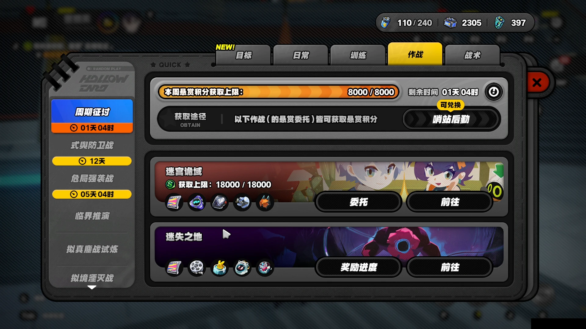

---
screen_names:
  - 贝果-研究站
  - 贝果-选图
  - 贝果-备战
  - 贝果-入场确认
  - 贝果-局内
  - 贝果-退出确认
  - 贝果-结算
  - 贝果-拟态单质提示
  - 贝果-仓库

appears_in:
  - 贝果计划
last_updated: 2026-10-18
---

# 贝果计划画面合集

本文说明研究站入口、入场、局内和仓库画面。玩法见[贝果计划](../gameplay/贝果计划.md)，自动化见[贝果计划自动化](../../develop/zzz/application/bagel.md)。区域坐标以 `assets/game_data/screen_info/bagel_*.yml` 为准。

素材格式与处理要求见[归档规范](../../develop/zzz/screenshot_archive.md)。逐份历史缺口见测试仓[BAGEL_MATERIALS.md](../../../zzz-od-test/BAGEL_MATERIALS.md)。本页描述画面事实，不把离线回归当作实机验收。

## 画面与资源

本文合并描述贝果的多个画面。“贝果计划”是合集名称。表中的 `screen_name` 是代码和画面资源使用的名称。区域坐标和识别参数以对应 YAML 为准。

| screen_name | 资源文件 | 包含状态 |
|---|---|---|
| 贝果-研究站 | [bagel_hub.yml](../../../assets/game_data/screen_info/bagel_hub.yml) | 达塔前、达塔对话、主界面 |
| 贝果-选图 | [bagel_map.yml](../../../assets/game_data/screen_info/bagel_map.yml) | 地图与难度选择 |
| 贝果-备战 | [bagel_prepare.yml](../../../assets/game_data/screen_info/bagel_prepare.yml) | 武备、装备、道具与携带容量 |
| 贝果-入场确认 | [bagel_enter_confirm.yml](../../../assets/game_data/screen_info/bagel_enter_confirm.yml) | 零携带提示、高危投资 |
| 贝果-局内 | [bagel_hud.yml](../../../assets/game_data/screen_info/bagel_hud.yml) | 局内常驻界面（HUD）、大地图、交互、解锁与搜查 |
| 贝果-退出确认 | [bagel_exit_confirm.yml](../../../assets/game_data/screen_info/bagel_exit_confirm.yml) | 主动退出确认 |
| 贝果-结算 | [bagel_result.yml](../../../assets/game_data/screen_info/bagel_result.yml) | 退出或失败后的结算 |
| 贝果-拟态单质提示 | [bagel_mimic_notice.yml](../../../assets/game_data/screen_info/bagel_mimic_notice.yml) | 带出的拟态单质失活提示 |
| 贝果-仓库 | [bagel_warehouse.yml](../../../assets/game_data/screen_info/bagel_warehouse.yml) | 入仓、满仓、批量出售、返回研究站与撤离奖励提示 |

## 子态

子态指同一画面资源中的不同显示状态。例如，`bagel_hub.yml` 同时包含达塔前、达塔对话和主界面。

| 子态 | 稳定特征 | 入口 → 出口 |
| --- | --- | --- |
| 达塔前 | 大世界快捷手册；达塔名称和交互提示 | 返回研究站 → F → 达塔对话 |
| 达塔对话 | 下方「达塔」；右侧「出发出发」 | 达塔前 → 出发出发 → 主界面 |
| 主界面 | 左上「迷宫诡域：贝果计划」；仓储枢纽；右下前往空洞 | 达塔对话、快捷手册或结算返回 → 前往空洞 → 选图 |
| 选图 | 地图卡、选中地图名、难度、推荐价值、前往备战 | 主界面 → 雅努斯/难度 → 前往备战 |
| 备战 | 背包/安全箱，武备/装备/道具与价值；预设组合、前往空洞 | 选图 → 前往空洞 → 入场提示 |
| 备战-物品详情 | 选中槽位高亮；物品名称、放入仓储枢纽等按钮 | 单击物品 → 详情；点击详情外空白处 → 备战 |
| 备战-预设组合 | 横排方案卡片；每张卡片分别有覆盖预设、应用预设 | 备战预设组合 → 横向滚动至目标卡片 → 应用预设 → 备战 |
| 备战打开的仓库 | 左侧背包与安全箱，右侧仓储库存；左下放入仓库，无返回研究站 | 备战前往仓库 → 左上返回 → 备战 |
| 入场确认 | 中央完整提示；取消/确认 | 确认携带与队伍提示 → 后续入场提示或投资页；具体顺序随条件变化 |
| 高危投资页 | 投资金额、额外回报、前往空洞 | 投资页 → 前往空洞 → 加载 |
| 开局大地图 | 右上「图例」、左上「[难度]地图名」、左上红底返回；没有喧响值 | 加载后自动弹出 → 点返回 → 局内；自动关闭时机待核实 |
| 局内 | 右下普通攻击按钮；右侧圆形小地图；右上计时 | 关开局地图之后 |
| 暂停菜单 | 右下退出；附近有暂离、脱离卡死 | 局内 Esc → 退出 → 专用确认 |
| 退出确认 | 「退出后仅保留安全箱内物资，其他物资将全部丢失」 | 确认 → DEFEAT |
| 结算 | DEFEAT、地图名、继续 | 继续 → 仓库 |
| 拟态单质提示 | 中央「带出的拟态单质已失活，转化为惰性单质」，下方「惰性单质无法进行合成」，底部确认 | 结算继续 → 仓库可能短暂显示 → 提示 → 确认 → 仓库 |
| 仓库 | 左侧背包与安全箱；放入仓库；结算仓库另有返回研究站 | 核对后返回贝果主界面或大世界，或留在仓库 |
| 撤离奖励提示 | 点击返回研究站后弹出「撤离奖励提示」「撤离奖励将自动转移至仓储枢纽」 | 确认 → 按入场来源返回 |
| 仓库-批量出售 | 底栏：取消出售、批量选择、确认出售 | 批量选择 → 快速选择 |
| 仓库-快速选择 | 类型、稀有度、符合条件数量、重置/确认 | 确认后回到出售底栏 |
| 出售预览 | 「确认出售以下道具」、预估价值、取消/确认 | 确认后弹出获得硬币 |
| 搜查面板 | 右侧容器标题、搜查中或搜索结果；左下安全箱 | 搜查中可拖已显露物品，搜索结果出现后才关面板、按 Esc 退出 |

贝果主界面通过主界面标题识别。仅看到达塔名称，不能确认角色已进入交互范围。`bagel_map.yml` 描述地图选择页，不能用于识别局内大地图。

其他玩法可能出现相似的确认框。确认贝果入场提示时，需要识别完整的提示文字。

高危投资页也显示研究站标题。仅识别到研究站标题时，无法确认当前画面是贝果主界面。

## 快捷手册入口

大世界右上角快捷手册打开后，选择「作战 → 周期征讨」。右侧「迷宫诡域」卡片包含标题、获取上限、奖励图标和「委托」「前往」两个按钮。「前往」直接打开贝果主界面，没有通用副本传送确认框；「委托」不是入场按钮。

上图为 WebP q90，仅供布局参考，不用于无损模板裁剪或流程验收。

识别复用[快捷手册通用区域](../../../assets/game_data/screen_info/compendium.yml)的「分类列表」「副本列表」「前往列表」，作战页签复用[作战区域](../../../assets/game_data/screen_info/compendium_combat.yml)。「迷宫诡域」标题位于左侧副本列表，「前往」在同一卡片右侧、标题下方。列表可滚动，不能仅按「前往」的全屏固定坐标点击。1080p 示例中，标题中心约为 `(603, 563)`，本卡片按钮中心约为 `(1475, 662)`；下张「迷失之地」的「前往」在更下方。

从快捷手册进入时，后续选图、备战、结算及仓库按钮布局不变。不能只凭「返回研究站」按钮名称判断返回位置，具体条件见[玩法入口](../gameplay/贝果计划.md#入口与单局)。自动化流程的待验证范围见[实机验证范围](../../develop/zzz/application/bagel_speedup.md#实机验证范围)。

## 各画面要点

**达塔前与对话。** 达塔名称可能显示在画面中部偏左，也可能居中。对话中仅点击已明确识别的「出发出发」。

**选图。** 未选中的难度文字也会显示。判断选中难度时，需要同时核对页签高亮和当前地图。仅识别到「困难」或「高危」不能确认选择。推荐等级和装备价值以当前界面显示为准。

**备战。** 备战页不显示当前地图名称。左上返回按钮可回到选图页。不同地图在同一难度下可能显示相同推荐价值，因此推荐价值不能用于确认地图。

零携带时，武备、装备和道具的三个价值均为 0。价值识别必须读取完整行。裁掉高位数字后读取末位，会导致错误的零值判断。金币图标也可能被识别为「0」。

**入场确认。** 零携带提示包括以下内容：

- 装备价值为 0，未达推荐价值。
- 存在未装备武备的代理人。
- 未穿戴队伍装备，包括异体刃和抗蚀器。

队伍未满编时，中央显示「代理人队伍未满编，是否继续出战？」，下方为「取消」「确认」按钮。此提示只说明队伍人数不足，不代表携带物已清空。

推荐价值随难度变化，因此需要读取完整提示。投资金额为白色，金币图标为金色。读取投资金额时，应滤掉金色图标，并保留完整数值左侧。

投资页金额下方的按钮从左到右依次为 MIN、-1M、-500K、+500K、+1M、MAX。MIN 对应 `贝果-入场确认/投资最小值`，需要完整匹配文字后点击。金额可能带单位，不能仅按纯数字读取。

归档非零投资画面中的白色金额为 `500K`，MIN 按钮外圈亮起。与零金额画面的对照见[来源说明](#来源说明)。

**局内与开局地图。** 加载画面只显示雅努斯名称，不能作为允许移动的依据。开局大地图通过「图例」和红底返回按钮识别，返回按钮复用 `menu/back`。点击返回后，需要等待右下普通攻击按钮出现。

存档 `screens/贝果-局内/高危A出生-原生1080.webp` 中，小地图下方显示 M，表示打开局内大地图的按键。`高危开局大地图-原生1080.webp` 的左上标题同时包含「高危」与「雅努斯幻境」，可以核对玩法与难度；不能仅凭计时或普通攻击判断玩法。

大地图上的地名不能作为玩家定位结果。角色箭头尖端与右侧黄色视野扇区的方向不同。静止箭头不能直接用于判断镜头方向。

**交互提示。** 可交互物的提示条显示在屏幕右侧。每条约高 75 像素，最多同时显示 3 条。提示超过 3 条时，顶部显示「切换」。`交互提示` 区域覆盖切换行和 3 个提示位置。`武备箱交互` 与 `电子保险箱交互` 使用同一区域，并分别匹配目标文字。

按 F 只对当前选中的提示生效。箱子头顶名称不能代替右侧提示条。受攻击时，画面可能只剩头顶名称，这不足以确认可以按 F 交互。

圆形 F 键使用图标模板识别。文字识别（OCR）可能漏识别 F，或将其读成 D。

**电子保险箱解锁。** 解锁界面上部中心显示「精确点按 F 或 Space」，下方显示 0/4 至 4/4 的进度。底部提示「解锁过程中受到攻击会被打断」。

解锁成功后，容器标题变为「电子保险箱」。状态随后从「搜查中…」变为「搜索结果」。「搜查中…」表示搜查仍在继续，不能作为允许关闭面板的依据。

**搜查受击中断。** 搜查或拖拽期间受到攻击会关闭搜查面板并回到局内。之后可以重新按 F 打开容器；自动化是否重开属于流程策略。右侧交互提示不一定同时出现。面板打开和关闭时有横向移动及淡入淡出，过渡中标题仍可能清晰。单帧标题漏识别不能直接判为受击。自动退出重开的条件见[贝果应用说明](../../develop/zzz/application/bagel.md)。

**电子保险箱交互。** 右侧 F 图标、电子保险箱提示和右下普通攻击按钮共同构成交互判断条件。具体规则见[贝果应用说明](../../develop/zzz/application/bagel.md)。

**暂停、退出、结算。** 暂停菜单复用战斗菜单的退出区域。空局结算的撤离点为「无」。该读数不能证明安全箱物资已丢失或已保留。结算识别需要完整地图标题，以区分困难和高危。

**拟态单质提示。** 带出的拟态单质失活时，结算点「继续」之后会弹出模态提示：中央标题「带出的拟态单质已失活，转化为惰性单质」、下方「惰性单质无法进行合成」、惰性单质格子和底部「确认」。仓库可能先短暂显示，再被提示覆盖。提示覆盖时，仓库背景模糊，底部按钮不可正常操作；确认后仓库恢复。识别区域以 `bagel_mimic_notice.yml` 为准，自动化处理见[贝果应用说明](../../develop/zzz/application/bagel.md#退出与结算提示)。连续片段与帧来源见[安全箱与结算提示素材索引](image/bagel_safe_and_notice/README.md)。

**仓库。** 「全部(N/M)」中的 N 表示占用。安全箱是否为空需要通过格子判断。未读到物品名称不能作为空箱依据。

研究站直接打开的仓库没有「返回研究站」按钮。结算仓库有该按钮，但批量出售时，底栏会将其替换为「确认出售」。

快速选择的未选中项为深灰底，选中项为蓝底，约为 红、绿、蓝（RGB）值 (0,145,255)。再次点击可取消选中。按钮图标中少量蓝色像素不能作为选中依据，例如门禁卡图标。

出售预览确认、底栏「确认出售」和获得硬币确认，使用三个独立区域。OCR 有时将「战术棱镜」读成「战术楼镜」，该文字匹配阈值放宽到 0.75。

结算仓库左侧可能先显示「撤离奖励」，再显示背包。背包标题和格子会因此下移。归档满仓画面中，背包 `0/20` 位于奖励物品下方，安全箱仍在底部，见[来源说明](#来源说明)。奖励物品和背包内容属于不同分区，不能直接搬运顶部第一格。

返回研究站时若出现撤离奖励提示，需要同时核对弹窗标题和奖励转移说明。该确认与出售确认使用不同区域。

### 满仓状态

仓库占用达到容量时，安全箱仍可能有遗留物品。仓库主界面可同时显示「放入仓库」「批量出售」和「返回研究站」。识别仓满不依赖独立弹窗。

识别时，分别读取「仓库数量」和「安全箱格子」区域。仓库占用达到容量与安全箱仍有物资是两个独立条件，必须分别核对。

这些画面事实不足以确定腾位方式或批量出售范围。自动化停止规则见[应用说明](../../develop/zzz/application/bagel.md)。

## 格子

仓库格子和局内搜查格使用同一套角标。快速选择按钮上的图标不能用作物品角标模板。局内识别类型包括特殊奖励（菲林／零号业绩）、贵重物品、蓝图、战术棱镜、装备、战术道具、门禁卡和其他。特殊奖励是程序的入箱分类，不是仓库筛选项。

战术棱镜至少有铃铛和人像两种角标。材料角标为白色箱子，对照图是 `assets/game_data/bagel/item_badges/material.png`。金币角标为白圈，对照图是同目录的 `currency.png`。未匹配的角标按「其他」处理。

角标位于卡片左上方，可能越过卡片外框。自动化搜索窗须保留完整角标，范围见[品质与角标识别](../../develop/zzz/application/bagel.md#品质与角标识别)。

角标模板位于 `assets/game_data/bagel/item_badges/`。白色图案需完整保留并居中。两种钻石角标、蓝图卷页角标和背包角标模板均为 24×26 像素，其余模板为 24×24 像素。

| 模板 | 类型 |
|---|---|
| `blueprint.png` | 蓝图 |
| `prism_char.png`、`prism_bell.png` | 战术棱镜 |
| `equip.png`、`backpack.png` | 装备 |
| `valuable_reward.png` | 特殊奖励（菲林／零号业绩） |
| `valuable.png` | 贵重物品 |
| `keycard.png` | 门禁卡 |
| `currency.png` | 金币 |
| `tactic.png` | 战术道具 |
| `material.png`、`other.png` | 材料 |

`other.png` 与 `material.png` 均为白色箱子材料角标。识别时，两者统一归为材料，使用相同的入箱优先级。未匹配的角标仍按「其他」处理。

### 蓝图角标

蓝图物品格左上显示白色卷页图案，顶部有横向卷边，中间有横线。该角标与普通抗蚀器、异体刃的盾牌角标、背包角标和战术道具角标不同。仓库详情中的「[蓝图]骸影·太初梦魔」与相邻蓝图共用卷页角标；不能仅因普通成品名称相同而归为蓝图。

局内搜索结果格和安全箱格也出现该卷页角标。归档分别包含 S 品质装备外观蓝图和 Z 品质骸影外观蓝图，未打开详情的格子不能据图案推断具体名称。

运行模板从仓库真实物品格裁取，不使用详情栏或快速选择按钮图标。来源见下文[角标来源与裁剪缺口](#角标来源与裁剪缺口)。

### 钻石与背包角标

钻石角标有两种外观。原有贵重物品角标在菱形轮廓内有星形留白；菲林／零号业绩使用另一种切面钻石图案，局内识别为特殊奖励。两者都不是金币的白圈角标。背包角标为带提手、翻盖和前袋的白色图案，与异体刃、抗蚀器的盾牌角标不同，属于装备。

第二种钻石模板来自录像解码帧；背包模板来自仓库未选中的真实物品格。来源见下文[角标来源与裁剪缺口](#角标来源与裁剪缺口)。

### 角标来源与裁剪缺口

[物品角标素材索引](image/bagel_item_badges/README.md)统一维护蓝图、第二种钻石和背包角标的源图、裁剪参数及像素限制。其他完整角标的归档画面见[来源说明](#来源说明)。无损归档可用于核对画面内容。其余历史模板的原始裁剪矩形和居中处理参数未完整留档，因此目前无法精确重建这些模板。

识别测试中的格心仅表示识别位置，不能作为裁剪矩形。更新模板时，需要从可核对的原始像素重新裁剪，并记录源图、矩形和处理参数。

格子底色表示稀有度：红为 Z，金为 S，紫为 A，蓝为 B，绿为 C。品质底色露在物品图案左右；下方数量与等级文字不表示品质。整格中位数或只选高饱和度像素都可能受图案影响，例如红底上的金色图案可能使 Z 被判为 S。自动化取样方法见[品质与角标识别](../../develop/zzz/application/bagel.md#品质与角标识别)，原像素对照见[品质取样对照](image/bagel_item_badges/README.md#品质取样对照)。格子上的黄点表示「建议出售」。

局部截图不能使用整屏 1080p 坐标。品质识别需要区分蓝底和紫底，避免将 B 判为 A。局部格子颜色不能用于识别整屏状态。

搜查结果显示两排五格。搜查面板中的背包也先显示两排五格，更多格子需要点击箭头查看。当前识别只读取可见的十格。

右侧物品格只显示图标和数量或等级，不显示完整名称。画面中的「F 全部拾取」和「双击搬运」提示，不能证明这些操作会将物品移入安全箱。

在仓库单击格子会打开详情，不会搬运物品。详情浮窗的按钮高度随物品类型变化，因此需要使用对应布局。详情中的词条等级不等于物品等级。局内搜查的详情布局尚未明确，不能沿用仓库坐标。

## 启动清空相关画面

安全箱和仓库的容量范围见[备战物资与仓储](../gameplay/贝果计划.md#备战物资与仓储)。下表中的 `0/5`、`186/280` 等读数只属于对应截图，不代表固定容量。识别占用时，需要同时读取当前容量。

以下归档画面均为原生 1080p，且已遮挡账号标识（UID）。用于携带读数、槽位和图标变化回归的画面采用无损 WebP。仅供画面参考的 `clear_loadout_dense_detail` 和 `preset_two` 采用 WebP q90。

表中的 `source_image` 路径均相对独立测试仓根目录。归档图用于核对画面来源和整屏识别，不能代替连续流程录像。自动化识别方式和验证范围见[清空战备说明](../../develop/zzz/application/bagel_clear_loadout.md)。

| 状态 | 可见事实 | source_image |
| --- | --- | --- |
| 有携带物的备战 | 三位代理人均有武备，价值 270000；装备 160000；道具 78000；背包 2/50，安全箱 0/5；左下前往仓库 | `screens/贝果-备战/clear_loadout_carried.webp` |
| 备战仓库转存前 | 背包 2/50；仓库 186/280；鼠标指针遮住「放入仓库」中的「仓」字 | `screens/贝果-仓库/clear_loadout_backpack_carried.webp` |
| 备战仓库转存后 | 背包 0/50，安全箱格为空；仓库 188/280；右下有双击搬运提示；没有返回研究站 | `screens/贝果-仓库/clear_loadout_prepare_warehouse_empty.webp` |
| 武备详情 | 第三位代理人武备高亮；右侧详情有放入背包、放入安全箱、放入仓储枢纽、出售和前往获取；底部旧转存提示同时存在 | `screens/贝果-备战/clear_loadout_weapon_detail.webp` |
| 已装备物品详情 | 右侧异体刃槽高亮；详情有放入背包、放入安全箱、放入仓储枢纽、出售和前往获取 | `screens/贝果-备战/clear_loadout_equipment_detail.webp` |
| 道具详情 | 最后一格道具高亮；详情数量 2/2，并有拆分选项 | `screens/贝果-备战/clear_loadout_item_detail.webp` |
| 零携带备战 | 三个价值都是 0，背包 0/20，安全箱 0/5；左侧仍是有物品的仓储候选列表 | `screens/贝果-备战/clear_loadout_empty.webp` |
| 第二件武备已转存 | 武备价值 90000，前两位武备槽为空，第三位仍有武备；装备 160000、道具 78000、背包 0/50、安全箱 0/5 | `screens/贝果-备战/clear_loadout_second_weapon_stored.webp` |
| 仅携带道具 | 武备与装备价值为 0，道具价值 78000，四格道具仍有物品；背包 0/20 | `screens/贝果-备战/clear_loadout_tools_only.webp` |
| 密集库存下的备战 | 左侧仓储候选列表显示多排同类骸影；右侧武备和装备价值为 0，道具价值 18000，背包 0/20、安全箱 0/5 | `screens/贝果-备战/clear_loadout_dense_inventory.webp` |
| 密集库存下的道具详情 | 左侧候选列表仍可见；右侧中央为骸影·太初梦魔详情，底部有入仓、拆分、出售等按钮 | `screens/贝果-备战/clear_loadout_dense_detail.webp` |
| 仓库背包六格物品 | 背包 6/50，首行六格有物；安全箱为空，仓库 182/280 | `screens/贝果-仓库/clear_carried_six_before.webp` |
| 同一仓库的图标动画另一帧 | 数量、格子位置和占用不变，首行前四格骸影图案明暗不同 | `screens/贝果-仓库/clear_carried_six_animation.webp` |

密集库存的两帧画面展示了不同物品选择下的候选列表。候选库存随选中物品类型变化，数量与携带占用无关。

六格背包的两帧画面中，数量、格子位置和占用一致。仓库物品图标也有明暗动画。图标像素是否静止不能作为物品是否仍在原格的依据。

**操作与方向。** 点击仓库左下「放入仓库」可快速转存左侧背包物品。快速双击备战右侧已装备的武备、装备和道具可转存物品，单击则打开详情。自动化操作和实测范围见[清空战备说明](../../develop/zzz/application/bagel_clear_loadout.md#实现与验证边界)。

| 画面 | 左侧内容 | 右侧内容 |
| --- | --- | --- |
| 仓库 | 携带物，包括背包和安全箱 | 仓储库存 |
| 备战 | 根据当前选择显示背包内容或仓储候选物品 | 已装备的武备、装备和道具 |

仅看到左侧有物品，不能判定角色有携带物。不同画面的搬运坐标需要分别使用。

详情布局随物品类型变化，不能共用菜单坐标：

- 武备详情在右侧，遮挡装备、道具及背包和安全箱读数。
- 装备、道具详情在中间，遮挡武备标题、价值和槽位。

点击详情外空白处可关闭详情；候选列表与备战面板之间的间隔没有物品格和按钮，候选列表本身不是空白区。详情打开时仍可能识别到底部两个按钮，不能据此判断无遮挡，也不能读取被覆盖的槽位。转存提示「已放入仓储枢纽」是短暂浮字，不属于新画面。

空武备槽的灰色图案和有物品的图标均有明暗动画。像素变化不能直接作为槽内物品变化的依据。

**预设组合。** 点击备战底部「预设组合」可打开横向卡片列表。卡片顶部显示方案名称和价值，底部显示「覆盖预设」和「应用预设」。向左拖动列表可查看右侧方案。

方案必须按卡片名称定位。名称「2」不表示固定的第二张卡片。应用现有方案可从仓储恢复装备，覆盖预设会修改方案。两项操作需要分别识别。

实拍 `screens/贝果-备战/preset_two.webp` 显示名称「2」、价值 508000 的方案。该方案由玩家自定义，不是所有账号均有的游戏默认方案。

**screen_info 现状。** 「前往仓库」、三位武备槽、三格装备、四格道具及对应空槽，尚无独立区域。详情浮窗和转存提示也尚无独立区域。当前识别方案见[清空战备说明](../../develop/zzz/application/bagel_clear_loadout.md#实现与验证边界)，区域和模板的建档方法见[画面建档技能](../../../skills/zzz-od-dev-screen-onboarding/SKILL.md)。

裁剪模板需要使用可核对像素的来源，并记录处理参数，见[素材归档规范](../../develop/zzz/screenshot_archive.md)。有损 WebP 转为 PNG 后，不能作为原始采集像素来源。

**实拍缺口。** 以下画面尚未归档：

- 备战仓库中，背包和安全箱同时非空的批量转存结果。
- 部分堆叠转出。
- 滚动到底。
- 自动排列。

结算仓库的满仓证据见[满仓状态](#满仓状态)。启动清空的实机验收范围见[清空战备设计](../../develop/zzz/application/bagel_clear_loadout.md#实现与验证边界)。

## 安全箱格子

古怪试炼的结果区和局内安全箱定位见[新赛季格子定位](image/bagel_item_badges/README.md#新赛季格子定位)。新赛季结果区存在两组相差 11 像素的高度；左侧安全箱格心约为 `X=259、360、461、562、663，Y=898`。这些素材与下面的第一赛季存档分开使用，不能只按文件日期推定排布相同。

局内搜查和仓库的安全箱位置不同。下表保留第一赛季存档的定位，使用缩放到 1920×1080 后的坐标，从左到右列出五个格心。仓库截图必须使用仓库坐标。

| 画面 | 格心 X | 格心 Y | 核对素材 |
| --- | --- | --- | --- |
| 局内搜查 | 259、360、461、561、663 | 899 | `四格安全箱部分占用-20261004.webp` |
| 仓库（启动转存与结算） | 267、371、475、579、683 | 897 | `带物资仓库-r07-117s.webp`、`入仓后安全箱空-实机.webp`、`clear_loadout_prepare_warehouse_empty.webp` |

局内搜查面板保留五个安全箱格子位置。未开放格保留外框，内部显示锁图标和 `LOCK`。空闲格没有锁定标记；新赛季可用空格也可能显示时钟图标，时钟与挂锁需要分别识别。对照素材见[安全箱与结算提示素材](image/bagel_safe_and_notice/README.md)。容量范围见[备战物资与仓储](../gameplay/贝果计划.md#备战物资与仓储)。

四格局内样本的右侧标题为「机械保险箱」，状态为「搜索结果」。安全箱第一格有物品，第二至第四格空闲，第五格锁定。该画面中的安全箱标题没有容量数字。背包的 `2/15` 仅表示背包占用，不能用于判断安全箱容量。

素材和模板记录见[来源说明](#来源说明)，自动化识别和验证范围见[收集与对换](../../develop/zzz/application/bagel.md#收集与对换)。

两格、三格安全箱的各画面，以及四格安全箱的备战和仓库画面，仍缺少原生截图。补充素材时，需要保留完整格子和可见容量读数，覆盖空箱、部分占用和满箱状态。素材归档到测试仓 `zzz-od-test/screens/`。

## 来源说明

下表中的路径均相对独立测试仓 `zzz-od-test` 根目录。归档素材用于核对对应画面状态。单帧截图不能证明持续时间、完整操作顺序或连续流程成功。像素来源和有损素材限制见测试仓 `screens/README.md` 与 `screens/bagel_archive.json`。

| 画面或用途 | 归档素材 |
| --- | --- |
| 达塔前、对话、主界面 | `screens/贝果-研究站/达塔前-原生1080.webp`、`screens/贝果-研究站/达塔对话-原生1080.webp`、`screens/贝果-研究站/主界面-原生1080.webp` |
| 雅努斯难度选择 | `screens/贝果-选图/雅努斯困难-原生1080.webp`、`screens/贝果-选图/雅努斯高危-原生1080.webp` |
| 零携带入场提示 | `screens/贝果-入场确认/高危零装备价值-原生1080.webp`、`screens/贝果-入场确认/未装备武备-原生1080.webp`、`screens/贝果-入场确认/未穿戴队伍装备-原生1080.webp` |
| 非零与零投资 | `screens/贝果-入场确认/高危投资500K-原生1080.webp`、`screens/贝果-入场确认/高危零投资-原生1080.webp` |
| 开局大地图 | `screens/贝果-局内/高危开局大地图-原生1080.webp`；仅支持画面外观核对 |
| 暂停与主动退出提示 | `screens/贝果-局内/暂停菜单-原生1080.webp`、`screens/贝果-退出确认/主动退出-原生1080.webp` |
| 失败结算 | `screens/贝果-结算/高危空局失败-原生1080.webp`、`screens/贝果-结算/超时空局-原生1080.webp` |
| 满仓遗留物资、撤离奖励提示 | `screens/贝果-仓库/满仓安全箱余一件-20260924.webp`、`screens/贝果-仓库/撤离奖励提示-20260924.webp` |
| 批量出售与确认 | `screens/贝果-仓库/仓库批量出售中.webp`、`screens/贝果-仓库/仓库快速选择.webp`、`screens/贝果-仓库/出售二次确认-20260921.webp`、`screens/贝果-仓库/出售获得硬币-20260921.webp` |
| 完整角标画面对照 | `screens/贝果-仓库/仓库角标完整-20260930.webp`、`screens/贝果-仓库/装备角标完整-20260930.webp`、`screens/贝果-局内/电子保险箱满箱对换失败-20260930.webp`；精确裁剪限制见[角标来源与裁剪缺口](#角标来源与裁剪缺口) |
| 四格安全箱局内布局 | `screens/贝果-局内/四格安全箱部分占用-20261004.webp` |

[安全箱锁图标模板](../../../assets/template/bagel/safe_slot_locked/config.yml)只裁取图标。`LOCK` 文字保留在整屏素材中。原图链接、文件摘要、裁剪矩形和处理参数统一记录在测试仓 `screens/bagel_archive.json`。UID 遮挡区域不涉及模板区域，因此无损归档可以精确重建该模板。

启动清空的读数、槽位、详情与预设画面索引集中在[启动清空相关画面](#启动清空相关画面)，不在本表重复列出。

## 缺口

- 启动清空相关画面的实拍缺口见[启动清空相关画面](#启动清空相关画面)。
- 开局大地图的自动关闭时机尚未确认。固定等待时长不能作为离开地图的依据。
- 局内物品详情布局尚未明确。
- 主动退出后是否保留已拾取的携带货币，尚未确认。
- 拟态单质提示已有[录像解码帧及连续片段](image/bagel_safe_and_notice/README.md)，仍缺直接采集的原生截图。哪些物品会失活、确认后每种物品的去向尚未全部核对。

## 投资金额素材

素材位于独立测试仓 `zzz-od-test/screens/贝果-入场确认/`。无损截图均已遮挡 UID，保留金额区域的识别像素。

| 用途 | 测试仓素材 | 可确认的范围 |
| --- | --- | --- |
| 七档投资金额 | `投资{0,500K,1M,1.5M,2M,2.5M,3M}-20261007-无损.webp` | 金币与金额整体居中，金额较长时金币及首位更靠左 |
| 金币高光误读 | `零投资金币误读2-20261007-无损.webp` | 白色过滤后金币高光仍可能被读为2，不能只凭图标主体为金色判断已排除 |

带框对照、逐帧记录和来源说明见测试仓 `screens/贝果-入场确认/金额识别对照/README.md`。识别方案见[投资金额归零](../../develop/zzz/application/bagel.md#投资金额归零)。

## 搜查面板过渡素材

归档位于独立测试仓 `zzz-od-test/screens/贝果-局内/搜查面板过渡/`，索引见该目录 `README.md`。无损帧及两段短片显示，面板关闭与重新打开都会使固定识别区域与格子错位。

`帧1103` 与 `帧1105` 属于玩家重新按 F 打开的过程，不表示游戏受击后自行恢复面板。

感兴趣区域（ROI）指只用于特定识别的图像范围。局内与仓库的实际格子识别范围见该目录的 `局内与仓库ROI对照.png` 和 `ROI坐标.json`；这些范围与面板稳定区域分开记录。

开关过渡素材中的安全箱为空，不能据此确认所有有物格子在不同光照下的识别效果。详细识别与流程策略见[搜查面板可操作性](../../develop/zzz/application/bagel.md#搜查面板可操作性)。
